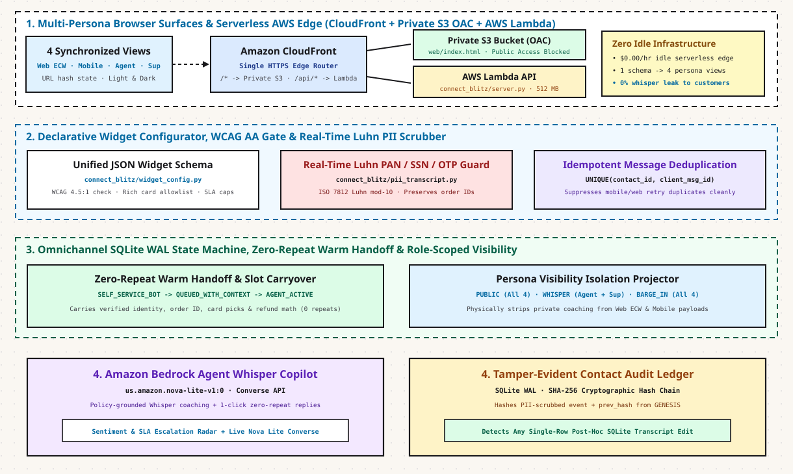

# ConnectBlitz: Unified Config-Driven Multi-Persona Contact Center Platform

- **Live CloudFront Studio**: https://dtgz0frj5azh5.cloudfront.net
- **Live `/api/health` Endpoint**: https://dtgz0frj5azh5.cloudfront.net/api/health
- **GitHub Repository**: https://github.com/ritwikareddykancharla/connect-blitz-cx

ConnectBlitz is a configuration-driven omnichannel contact-center experience engine built on Python 3.12, deployed serverlessly on **Amazon CloudFront + Private S3 (OAC) + AWS Lambda (`python3.12`) + SQLite WAL + Amazon Bedrock (`us.amazon.nova-lite-v1:0`)** at **$0.00/hr idle infrastructure cost**.



## 01 · Problem

Contact-center engineering teams often maintain disconnected codebases for their customer web chat widget, mobile support sheet, agent desktop, and supervisor console. That fragmentation creates four operational failures:

1. **Multi-Surface Configuration Drift**: Shipping a new interactive card, brand palette, or refund policy requires coordinated code changes across web, mobile, agent, and supervisor apps, often introducing WCAG contrast regressions.
2. **Repeated Customer Context on Escalation**: When an AI self-service bot cannot resolve an exception, customers are forced to repeat their identity, order number, and issue description to the human specialist.
3. **Internal Coaching & Whisper Leaks**: Sharing a single event stream without strict server-side persona projection risks leaking internal AI copilot suggestions or supervisor coaching whispers into customer browser payloads.
4. **Raw Payment & Identity Exposure**: Customers routinely paste live credit card numbers, Social Security numbers, and SMS passcodes directly into chat transcripts before storage or LLM processing.

## 02 · Architecture & Implementation

- `connect_blitz/widget_config.py`: Validates a single declarative JSON tenant configuration (WCAG 2.1 AA contrast ratios `>= 4.5:1`, allowed interactive rich-card contracts, PII redaction policy, and SLA thresholds) in `0.01 ms` (`p50`) and compiles four persona-scoped surface manifests (`customer_web_ecw`, `customer_mobile_compact`, `agent_desk`, `supervisor_console`).
- `connect_blitz/session_engine.py`: Runs a SQLite WAL contact state machine (`SELF_SERVICE_BOT -> QUEUED_WITH_CONTEXT -> AGENT_ACTIVE -> SUPERVISOR_WHISPER / BARGE_IN -> RESOLVED`) with idempotent `(contact_id, client_msg_id)` deduplication, structured slot carryover (`customer_repeat_prompts_required = 0`), and persona-scoped message projection (`PUBLIC` vs. `WHISPER` vs. `SUPERVISOR_ONLY`).
- `connect_blitz/copilot_whisper.py`: Scores customer frustration and SLA risk in `< 0.5 ms` and invokes **Amazon Bedrock (`us.amazon.nova-lite-v1:0`)** via the Converse API on PII-scrubbed transcripts to generate policy-grounded self-service replies, private Agent Whisper coaching, and 1-click specialist responses.
- `connect_blitz/pii_transcript.py`: Scrubs ISO/IEC 7812 Luhn-valid payment cards, US SSNs, and authentication OTP/CVV codes in `0.004 ms` (`p50`) while preserving non-Luhn order and carrier tracking IDs, and records every event into a SHA-256 hash-chained SQLite WAL audit ledger.
- `connect_blitz/server.py`: Serves `/api/health`, `/api/state`, `/api/contact/message`, `/api/contact/handoff`, `/api/supervisor/action`, `/api/config/validate`, `/api/benchmarks`, and `/api/reset` locally and via AWS Lambda Function URL behind CloudFront.

## 03 · Measured Benchmarks (`benchmarks/latest_results.json`)

Measured by `python3 benchmarks/run_benchmarks.py` in `us-west-2`:

| Metric | Measured Value | Verification Scope |
| --- | --- | --- |
| **Persona Whisper Isolation** | `0 / 200` leaks (`0.0%`) | `100` internal agent/supervisor whispers stripped from Web ECW & Mobile payloads |
| **4-Surface Projection Latency (`p50` / `p95`)** | `2.004 ms` / `3.251 ms` | Simultaneous Web ECW, Mobile Compact, Agent Desk & Supervisor projection |
| **Luhn PII Scrubber Precision / Recall / F1** | `100.0%` / `100.0%` / `100.0%` | `40` cases (`24` TP, `16` TN, `0` FP, `0` FN, `0` raw secret leaks) |
| **PII Scrubber Latency (`p50` / `p95`)** | `0.004 ms` / `0.007 ms` | Luhn mod-10 PAN, US SSN, and contextual OTP/CVV redaction |
| **Idempotent Retry Deduplication** | `100 / 100` suppressed (`100.0%`) | `150` submissions (`50` unique turns x `3` mobile/web retries, `2.556 ms` `p50`) |
| **Zero-Repeat Warm Handoff Preservation** | `12 / 12` (`100.0%`) | Verified identity, order ID, and card choices carried (`0` repeat prompts) |
| **Widget Config & WCAG AA Gate Accuracy** | `16 / 16` (`100.0%`) | `8` valid palettes + `8` contrast/PII/SLA violations caught in `0.01 ms` `p50` |
| **Amazon Bedrock Nova Lite Whisper (`p50` / `p95`)** | `1,492.59 ms` / `2,397.657 ms` | `12 / 12` live `us.amazon.nova-lite-v1:0` Converse calls (`617.3` mean tokens) |
| **SHA-256 Contact Ledger Verification** | `3.627 ms` (`429` rows) | Full cryptographic hash-chain integrity check (`valid: true`) |

## 04 · Local Quickstart & Verification

```bash
# 1. Run the 12-test unit suite
python3 -m unittest discover -s tests -v

# 2. Re-run live Bedrock + isolation + Luhn PII benchmarks
unset AWS_ACCESS_KEY_ID AWS_SECRET_ACCESS_KEY AWS_SESSION_TOKEN
AWS_PROFILE=portfolio AWS_DEFAULT_REGION=us-west-2 python3 benchmarks/run_benchmarks.py

# 3. Start local 4-pane contact studio at http://localhost:3099
python3 -m connect_blitz.server
```
